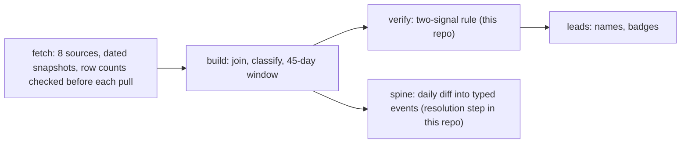

# Pilot Light: verification kernel

Pilot Light tracks Texas restaurant and bar projects from public records before they open. It
joins eight state sources, including liquor-licence applications, sales-tax permits, franchise-tax
officer records and construction filings. This repo publishes two parts of it. The first decides
whether records from different sources describe the same place. The second works out what
happened to a licence application after it left the pending list. The source fetchers, lead
scoring and the product site stay private.

## Run it

Python 3.9 or later. Standard library only.

```
python3 examples/walkthrough.py
python3 -m unittest discover -s tests -t .
```

The walkthrough runs two synthetic venues against ten candidate records. An excerpt of its
output, with the signal lines and two rows left out:

```
A restaurant in its own building: Juniper Smokehouse, 4100 Example Pkwy, Austin
  a1  ACCEPT  ENTITY+TRADE             the same restaurant in the permit file
  a2  reject  names_only_no_city       a same-named business 500 miles away
  a3  reject  single_key:TRADE         a different restaurant sharing one distinctive word
  a4  reject  address_only             an earlier business at the same address

A restaurant in a shopping centre: Cedar and Salt, 2200 Sample Blvd Ste 5, Houston
  b1  ACCEPT  ENTITY+SUITE+TRADE       the same restaurant, same suite
  b2  reject  multi_tenant_no_suite    a gym three doors down
  b6  reject  multi_tenant_no_suite    the same owner's second restaurant in the same centre
  b5  reject  multi_tenant_no_suite    the same company, permit filed without a suite
```

## Where this sits in the pipeline



The production spine keeps every daily snapshot's changes in an event store. This repo has an
in-memory version of its hardest step only.

## The join rules and the failures behind them

On 2026-08-14 I measured what single-field joins were doing, and the results were bad enough to
change the rule for every join in the product. Name-token matching found 261 construction-record
"matches", and 18 of them survived an address check, a 93 percent false-positive rate. An address
fallback attributed a coffee chain's corporate officer to an unrelated cafe in the same building.
Neighbouring tenants inflated construction coverage from 6.8 to 16.5 percent. Three source pulls
returned zero rows without raising, because of a field name that did not exist, a double-encoded
`%`, and an API that caps pages at 100 while accepting a request for 1,000.

The rules that came out of that day are in `pilot_light/verify.py`:

1. A join needs two independent signals to agree: legal entity, trade name, tax id, a person's
   name, or a matching suite.
2. A shared street address is never a signal. It only narrows the candidates.
3. In a building with three or more tenants, the suite has to match.
4. Two name signals alone also need the same city. This rule was added on 2026-10-23 (see below).
5. A source that returns zero rows is a bug until shown otherwise.

Each rule has regression tests in `tests/test_verify.py`. Eleven of the 24 tests also run a
defective version of the code from `tests/defects.py`, which has to reproduce the original wrong
answer, so each of those tests is shown to catch its bug. The others check that true matches still
pass and cover cases with no historical defect. Each defect is labelled PRESERVED (the production
code as it was), ADAPTED (the production rule, rewritten only to fit this repo's interfaces) or
RECONSTRUCTED (rebuilt from the failure log, because the original was replaced the same day).
The zero-row guards wrap the source pulls in the private fetchers, so here they are tested on
their own.

## Licence outcomes and the publishing lag

The state publishes issued licences one to two business days late, so an application that leaves
the pending list today usually cannot be matched to its licence yet. `pilot_light/transitions.py`
parks it and decides only after the issued file has published through that day. Of the first 34
licences parked this way, 16 turned out to be approvals. Calling them on the day would have been
wrong 47 percent of the time.

The pending row's licence id also misleads. At an existing venue it can point at the licence
already on the wall, and six of the first seven approvals found by backfill were licences issued
years before the application. An issue date earlier than the filing date is now rejected as an
approval.

## The numbers, and when each was measured

| Figure | Value | Measured |
|---|---|---|
| Raw licence filings in a 60-day window | 535 | 2026-08-14 |
| Distinct projects after deduplication | 369 | 2026-08-14 |
| Statewide run rate | 184 distinct projects a month, of which 36 percent are expansions and 16 percent licence changes | 2026-08-14 |
| Projects with a verified person's name | 43.4 percent (95 percent interval 38.4 to 48.5) | 2026-08-14 |
| Parked licences that turned out to be approvals | 16 of 34 | 2026-08-25 |

The 184 replaced an early figure of about 500 a month. That number was a count of every alcohol
notice in the state, and I had read it as the food-service inventory. A Codex review caught it.

## Three defects found while preparing this repo

On 2026-10-23 a Codex review of the publication plan probed the production code and reported three
defects. I confirmed each one by reading the code. All three are fixed here and covered by tests.
The production pipeline has not run
since August 2026 and has not received these fixes yet.

- Entity name and trade name both come from names, so a same-named
  business in another city could pass the two-signal rule. In production the callers narrow
  candidates by venue or building first, which mostly hid this. The rule itself never enforced it.
- The tenant census counted rows, so one tenant filed twice made a two-tenant building look like a
  shopping centre and suppressed a true match.
- An application that dropped off the pending list for
  a day and came back kept its parked date and was later reported as having left.

## What this repo does not show

- No one has hand-checked a sample of accepted and rejected joins, so precision and recall are
  unmeasured.
- Every record here is synthetic. No real filings, names or addresses are included.
- The figures above come from runs through 2026-08-25, and the pipeline has not run daily since.
- Rule 3 rejects the right company when its permit leaves out the suite (candidate `b5` in the
  walkthrough).
- A sole proprietor's entity name and person name can be the same string, so those two signals
  are less independent than they look.

## How it was built

I designed the pipeline and chose its sources, and I wrote each join rule after the failure that
prompted it. The code
was written with Claude Code under my direction. Codex reviewed the work in three rounds (data,
product and launch readiness), and every finding was fixed and re-checked. A fourth review, before
publication, found the three defects above. `PROVENANCE.md` lists what was extracted, adapted or
written new for this repo.
